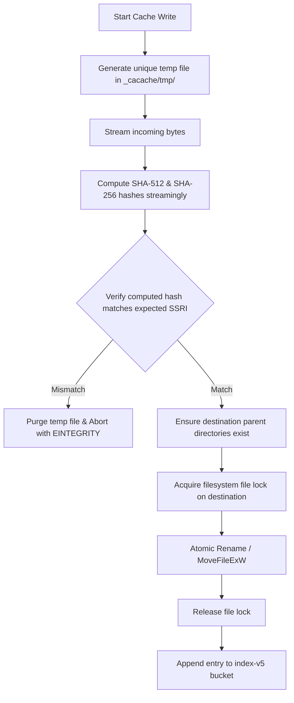

# Content-Addressable Cache Contract

## 1. Architectural Overview & On-Disk Layout

`rnpm` implements a high-throughput, cross-process content-addressable storage (CAS) engine with 100% on-disk compatibility with npm's `cacache` (`content-v2` and `index-v5` formats).

The cache directory layout under `<cache-dir>/_cacache/` is:

```text
<cache-dir>/_cacache/
├── content-v2/
│   └── sha512/
│       └── 0a/
│           └── 1b/
│               └── 0a1b2c3d4e5f... (raw uncompressed or gzip tarball payloads)
├── index-v5/
│   └── sha256/
│       └── e3/
│           └── b0/
│               └── e3b0c44298fc... (bucket files containing newline-delimited index entries)
└── tmp/
    └── tmp-<uuid> (transient staging files during writes)
```

### 1.1. Content-Addressable Storage (`content-v2`)
- **Keying:** Blobs are keyed directly by their cryptographic hash (default algorithm: `sha512`).
- **Sharding:** Paths are sharded using the first two characters (`h0`) and next two characters (`h1`) of the hex-encoded digest:
  `content-v2/<algorithm>/<h0>/<h1>/<full-hex-digest>`
- **Immutability:** Once written and verified, content files are immutable. Multiple packages sharing the same tarball hash reference the exact same file on disk.

### 1.2. Metadata Index (`index-v5`)
- **Index Keys:** Arbitrary string keys, such as registry packument URLs (e.g. `make-fetch-happen:request-cache:https://registry.npmjs.org/react`).
- **Bucket Sharding:** The key is hashed using SHA-256. The first 4 hex characters determine the bucket file location:
  `index-v5/sha256/<h0>/<h1>/<full-hex-digest>`
- **Bucket Content:** An append-only file containing newline-delimited JSON objects:
  ```json
  {"key":"https://...","integrity":"sha512-...","time":1730456000000,"size":14256,"metadata":{}}
  ```
- **Resolution:** When reading from an index bucket, the latest entry matching the exact key string wins.

---

## 2. Multi-Process Atomic Write Protocol

To prevent corrupted files, partial reads, or race conditions across concurrent processes, all writes adhere strictly to the atomic staging protocol.



### 2.1. In-Volume Staging Requirement
- Temporary staging files **MUST** be created inside `<cache-dir>/_cacache/tmp/` on the **same physical filesystem volume** as the `content-v2` directory.
- On Windows NTFS, `MoveFileExW` with `MOVEFILE_REPLACE_EXISTING` is guaranteed atomic if and only if both paths reside on the same drive (`D:\`). Cross-volume moves fall back to copy-delete, which is non-atomic and vulnerable to race conditions.

### 2.2. Atomic File Replacement
- Target path: `<cache-dir>/_cacache/content-v2/<algo>/<h0>/<h1>/<hash>`
- Windows API: `MoveFileExW(tempPath, destPath, MOVEFILE_REPLACE_EXISTING | MOVEFILE_WRITE_THROUGH)`
- Unix API: `rename(tempPath, destPath)`

---

## 3. Concurrency, Locking & Stale Lock Recovery

Concurrent package manager processes (or parallel threads within `rnpm`) may attempt to read or write the same cache entries simultaneously.

### 3.1. File Locking Implementation
- **Index Updates:** Concurrent writes to the same `index-v5` bucket acquire an exclusive file lock (`LockFileEx` on Windows, `flock`/`fcntl` on Unix) on `<bucket>.lock`.
- **Content Writes:** Before renaming the temp file to the final content path, an exclusive lock is acquired if the file already exists. If the destination file already exists and passes size/integrity checks, the temp file is simply deleted without overwriting.

### 3.2. Stale Lock Detection & Recovery
Locks may become orphaned if a process crashes, is killed via `SIGKILL`, or experiences power loss.
- **Lock Format:** Lock files store a JSON payload: `{"pid": 1234, "created_at": 1730456000}`.
- **Recovery Rules:**
  1. If a lock file exists, test whether the holding `pid` is currently alive on the host. On Windows, open the process handle with `OpenProcess(PROCESS_QUERY_LIMITED_INFORMATION, FALSE, pid)`. If the process does not exist, the lock is stale.
  2. If the lock age exceeds the maximum timeout threshold (**60 seconds**), treat the lock as expired.
  3. Reclaim the lock: delete the orphaned `.lock` file and re-acquire.

---

## 4. Corruption Detection & Self-Healing Workflow

Disk corruption, aborted writes, or network truncation must never result in permanent failures or poisonous cache states.

### 4.1. Cache Read Verification
Whenever a cached tarball is retrieved for extraction:
1. Verify that the file size matches the size recorded in the index.
2. Verify stream integrity by computing the digest and comparing against the recorded SSRI string.
3. Validate gzip header and tar magic headers (`ustar`).

### 4.2. Self-Healing Procedure (Automatic Recovery)
If any verification check fails:
1. **Quarantine / Unlink:** Immediately unlink the corrupted content file from `content-v2/...` and remove the key entry from `index-v5/...`.
2. **Network Fallback:** Fall back transparently to fetching the package directly from the remote registry.
3. **Atomic Re-population:** Stream the fresh response, verify its integrity, and atomically write the clean blob into the cache.
4. **Diagnostic Logging:** Record a structured warning:
   ```text
   npm warn cache Corrupted cache entry detected for '<package>'. Purged and refetched from registry.
   ```

---

## 5. Garbage Collection & Cache Maintenance

### 5.1. Temporary File Cleanup (`tmp/`)
- During cache operations, any file in `<cache-dir>/_cacache/tmp/` whose last modified timestamp is older than **24 hours** is identified as an abandoned artifact from a crashed process and unlinked.

### 5.2. Cache Verification (`rnpm cache verify`)
1. Scan all entries in `content-v2/`: verify checksum for every file. Delete corrupted blobs.
2. Scan all entries in `index-v5/`: remove index pointers referencing missing content files.
3. Compact index bucket files by removing superseded duplicate keys.
4. Report total verified entries, reclaimed disk space, and integrity status.
