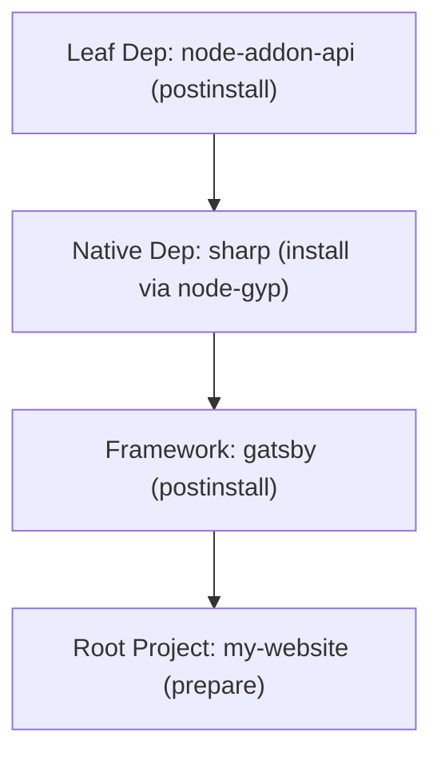

# Lifecycle Scripts Execution & Security Contract

## 1. Lifecycle Phases & Execution Hooks

npm package manifests define hooks executed automatically during package installation, removal, or manual execution via `rnpm run <script>`.

### 1.1. Standard Installation Hooks
1. `preinstall`: Executes before a package is unpacked/linked into `node_modules`.
2. `install`: Executes during installation (commonly used for native C/C++ compilation via `node-gyp`).
3. `postinstall`: Executes after a package and all its dependencies are linked.
4. `prepare`: Executes after installation and before packing.

### 1.2. Root Package vs Dependency Rules
- **Root Package:** When `rnpm install` is invoked without arguments, the root package executes:
  `preinstall` -> (install dependencies) -> `install` -> `postinstall` -> `prepare`.
- **Registry Dependencies:** Packages installed from a remote npm registry **NEVER** run `prepare`. They run only `preinstall`, `install`, and `postinstall`.
- **Local `file:` Dependencies:** Local packages referenced via `file:` run `prepare` upon installation, mirroring root behavior.
- **Bundled Dependencies:** Packages marked `inBundle` are unpacked directly from the parent tarball; they do not trigger registry lookups and run their lifecycle scripts in bottom-up order.

---

## 2. Execution Ordering: Bottom-Up Topological Sequence

To guarantee that build scripts have access to their required dependencies and binaries, lifecycle scripts for dependencies are executed in **bottom-up topological order**:

1. Leaf dependencies (packages with no transitive dependencies) execute first.
2. Dependent packages execute only after all of their child dependencies have successfully completed their lifecycle hooks.
3. The root project scripts execute last.



---

## 3. Environment Variable Construction

When spawning a lifecycle script, `rnpm` constructs a dedicated execution environment conforming to the npm standard:

### 3.1. Hierarchical `PATH` Construction
`PATH` is reconstructed by prepending binary directories in order of proximity:
1. `node_modules/.bin` of the package executing the script.
2. `node_modules/.bin` of every ancestor directory up to the workspace root.
3. Directory containing the active `node` executable.
4. System `PATH`.

This ensures scripts can execute binaries provided by their direct and transitive dependencies without global installation.

### 3.2. Standard npm Environment Variables
- `INIT_CWD`: Absolute path to the directory where the user initially ran the CLI.
- `NODE` / `npm_node_execpath`: Absolute path to the active Node.js binary.
- `npm_execpath`: Absolute path to the `rnpm` executable.
- `npm_lifecycle_event`: Current hook name (e.g. `install`, `postinstall`, `build`).
- `npm_lifecycle_script`: The exact command string declared in `package.json`.
- `npm_package_name`: Package name from the active `package.json`.
- `npm_package_version`: Package version from the active `package.json`.
- `npm_package_json`: Absolute path to the active `package.json`.
- `npm_config_*`: Configuration parameters transformed to lowercase environment variables (e.g. `npm_config_user_agent`).

---

## 4. Credential Scrubbing & Security Boundary

Lifecycle scripts written by third-party package maintainers run arbitrary shell code. Under no circumstances may authentication credentials or private tokens leak into child process environments.

### 4.1. Sensitive Credential Scrubbing Rules
Before spawning any child process, the environment map must be scrubbed:
1. Strip all configuration keys containing:
   - `_authToken`
   - `_password`
   - `_auth`
   - `password`
   - `token`
2. Strip URI-scoped auth tokens:
   - `//registry.npmjs.org/:_authToken`
   - `//npm.pkg.github.com/:_authToken`
   - Any key matching `^//.*:_authToken$`
3. Sanitize `npm_config_user_agent` to exclude private token references.

### 4.2. Logging & Error Scrubbing
If a script fails, stdout/stderr captured in logs or console output must be filtered to prevent accidental display of bearer tokens present in command lines or error traces.

---

## 5. Shell Selection & Process Invocation

### 5.1. Operating System Shell Matrix
- **Windows:**
  - Shell command: `cmd.exe /d /s /c "<script>"`
  - Flag `/d`: Disables execution of AutoRun commands from registry.
  - Flag `/s`: Modifies handling of string after `/c` to preserve quoting.
  - Script strings containing `&`, `|`, `%`, `^`, or `"` are preserved verbatim.
- **Unix (Linux & macOS):**
  - Shell command: `/bin/sh -c "<script>"`

### 5.2. Script Controls (`--ignore-scripts`)
- If `--ignore-scripts` is passed on the command line, all lifecycle scripts (`preinstall`, `install`, `postinstall`, `prepare`) for both dependencies and the root package are skipped entirely.
- Packages are still extracted, linked, and recorded in the lockfile.

---

## 6. Process Tree Cleanup & Signal Termination

Lifecycle scripts frequently spawn child sub-processes (such as Python compilation helpers, CMake, or child Node processes). When a build fails, times out, or the user presses Ctrl+C (`SIGINT`), orphaned child processes must not remain running in the background.

### 6.1. Windows Job Object Containment
On Windows, every spawned script process is associated with an active Windows Job Object configured with:
```c
JOBOBJECT_EXTENDED_LIMIT_INFORMATION info;
info.BasicLimitInformation.LimitFlags = JOB_OBJECT_LIMIT_KILL_ON_JOB_CLOSE;
SetInformationJobObject(hJob, JobObjectExtendedLimitInformation, &info, sizeof(info));
```
When `rnpm` terminates or closes the job handle, the Windows kernel automatically terminates all processes in the job tree simultaneously.

### 6.2. Unix Process Group Termination
On Unix systems, scripts are spawned in a distinct process group (`setpgid(0, 0)`). Upon receiving `SIGINT` or `SIGTERM`, `rnpm` forwards the signal to the entire process group:
```c
kill(-pgid, SIGTERM);
```

---

## 7. Optional Dependency Build Failure Isolation

Native packages (e.g. `fsevents`, platform-specific prebuilts) are often declared as `optionalDependencies`.
- If an optional dependency fails during `preinstall`, `install`, or `postinstall` (exit code != 0):
  1. The error is intercepted.
  2. A warning is emitted:
     ```text
     npm warn optional SKIPPING OPTIONAL DEPENDENCY: <pkg>@<version> (node_modules/<pkg>):
     npm warn optional <pkg> failed at the <stage> script.
     ```
  3. The failed package directory is removed from `node_modules`.
  4. The parent installation continues without error and exits with code `0`.
